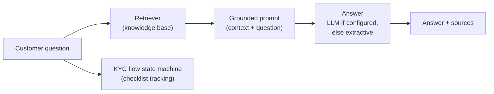

# GenAI Banking Assistant — FinAI 360 GenAI Module

A clean-room demonstration of the generative AI banking assistant from
**FinAI 360**, the intelligent banking automation suite I built at Edward
Jones: retrieval-augmented generation over a banking knowledge base,
grounded answering, and guided multi-step flows such as KYC onboarding.

> **What this repo is:** a from-scratch re-implementation of the module's
> architecture and approach, running on sample documents. It contains no
> employer code, no customer data, and no production artifacts. Production
> outcomes below describe the production system; demo results describe
> this repo's runs.

## Production context

In production, virtual banking assistants powered by OpenAI GPT and
LangChain RAG automated KYC verification, onboarding, and account
servicing — resolving over 85% of customer queries autonomously and
reducing manual support effort. The key discipline was grounding: the
model answered only from retrieved documents, and said it did not know
when the documents were silent.

## Architecture



This demo implements the same RAG shape with a dependency-light TF-IDF
retriever (LangChain itself is not a dependency here) and an optional
generative step via any OpenAI-compatible API. The Flask API (`app.py`)
exposes both asking and the KYC checklist.

## Demo results (sample documents, measured)

Retrieval top-1 accuracy on 6 representative customer questions
(KYC documents, onboarding, address change, card activation, loan
timing, fraud reporting): **6/6**. Small sample, reported as-is — the
point is the pipeline shape (retrieve → ground → answer → cite), not a
benchmark claim.

Try it:

```bash
python src/qa.py "What documents do I need for KYC?"
python src/qa.py "I see a transaction I do not recognize, what do I do?"
python src/qa.py "What is the weather on Mars?"   # -> says it doesn't know
```

## Run it

```bash
pip install -r requirements.txt

# Ask a question from the command line
python src/qa.py "How do I activate a new debit card?"

# Serve the assistant API (port 5001)
python src/app.py
# POST /ask  {"question": "..."}  -> {"answer": ..., "sources": [...], "mode": ...}
# POST /kyc  {"session_id": "s1", "step": "identity_document"} -> checklist status
```

Set `OPENAI_API_KEY` (and install `openai`) for generative answers; without
it, answers are extractive passages from the retrieved documents, labeled
as such.

Tests: `python -m pytest tests/ -q`.

## Project structure

```
src/
  retriever.py    banking knowledge base, chunking, TF-IDF retrieval
  qa.py           grounded QA: extractive fallback + optional LLM step
  flows.py        KYC onboarding checklist state machine
  app.py          Flask API: /ask and /kyc
tests/
  test_smoke.py   retrieval, QA grounding, and flow checks
```

## Tech stack

Python, scikit-learn (TF-IDF retrieval), Flask — demonstrating the
production OpenAI GPT + LangChain RAG pattern in runnable, dependency-light
form.

## License

MIT
